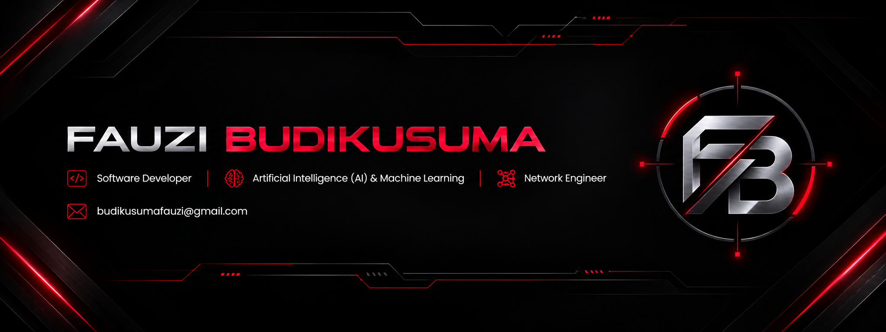
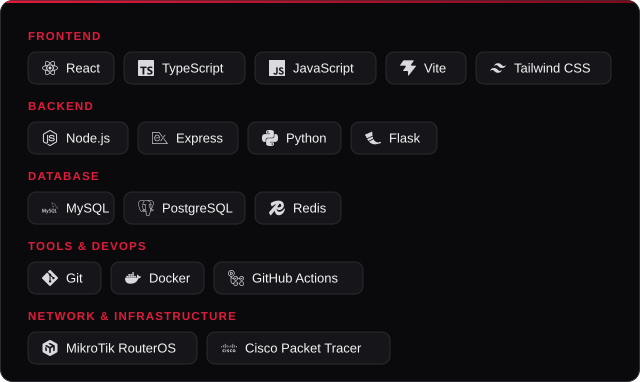
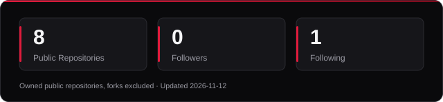
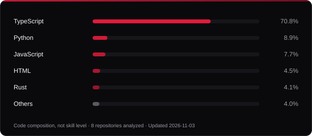

  

## About Me

I'm an Informatics enthusiast focused on software development, artificial intelligence, and network infrastructure. I enjoy building practical, reliable solutions, exploring emerging technologies, and continuously strengthening my technical skills.

## Technology Stack

  

## GitHub Statistics

  

## Top Languages — Based on Public Repository Code

  

This chart shows code composition across public repositories. It is not a measure of skill level or proficiency.

## Connect

  <a href="mailto:budikusumafauzi@gmail.com">budikusumafauzi@gmail.com</a>
  &nbsp;·&nbsp;
  <a href="https://www.linkedin.com/in/fauzi-budikusuma/">LinkedIn</a>
  &nbsp;·&nbsp;
  <a href="https://github.com/budikusumafauzi-sketch">GitHub</a>

Yogyakarta, Indonesia

